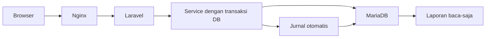

# ERP Distribusi / Trading

[](https://github.com/widiartowahyu3/erp-laravel/actions/workflows/ci.yml)

Sistem ERP untuk perusahaan distribusi dan trading: pembelian, persediaan multi-gudang, penjualan, piutang dan utang, pembayaran, jurnal otomatis, serta laporan keuangan. Dibangun sebagai monolit dengan Laravel 13, Vue 3 lewat Inertia, MariaDB, dan Docker.

Setiap dokumen yang diposting membuat jurnal dalam transaksi yang sama, jadi stok, piutang, utang, dan laporan keuangan membaca sumber yang sama. Batasan yang disengaja tertulis di [`docs/LIMITATIONS.md`](docs/LIMITATIONS.md).

## Fitur per modul

| Modul | Isi |
|---|---|
| Master Data | Produk, kategori, satuan, gudang, pemasok, pelanggan, tarif pajak, syarat pembayaran |
| Pembelian | Pesanan pembelian, penerimaan barang parsial, faktur pembelian, utang per pemasok |
| Persediaan | Saldo per gudang, mutasi, kartu stok, penyesuaian stok, biaya rata-rata bergerak |
| Penjualan | Pesanan penjualan dengan pengecekan batas kredit, surat jalan parsial, faktur penjualan, piutang per pelanggan |
| Akuntansi | Bagan akun, jurnal otomatis dan manual, jurnal pembalik, pembayaran masuk dan keluar dengan alokasi ke faktur |
| Laporan | Neraca saldo, buku besar, laba rugi, neraca, umur piutang dan utang, kartu piutang, rekonsiliasi persediaan, ringkasan operasional |
| Cetak dan ekspor | Tampilan cetak dokumen dan laporan, ekspor CSV untuk laporan dan daftar |
| Administrasi | Pengguna, peran dan hak akses, log audit dengan retensi 7 hari |

Dokumen transaksi punya siklus status yang dijaga server. Dokumen yang sudah diposting tidak bisa diubah, hanya dibatalkan dengan jurnal pembalik.

## Arsitektur singkat



- Uang dan kuantitas dihitung sebagai string desimal lewat `bcmath`, tanpa `float`.
- Aplikasi memakai akun database `erp_app` yang hanya punya hak baca dan tulis data. Migrasi memakai akun terpisah.
- Log audit bersifat fail-closed: bila gagal dicatat, transaksinya ikut batal.

Rincian ada di [`docs/ARCHITECTURE.md`](docs/ARCHITECTURE.md).

## Menjalankan

Prasyarat: Linux atau WSL2, Docker dengan Compose v2, `make`, `git`, dan `openssl`.

```bash
git clone git@github.com:widiartowahyu3/erp-laravel.git erp-trading
cd erp-trading
make hooks
```

Siapkan berkas rahasia. Kata sandi dibuat acak di mesin kamu dan tidak pernah masuk ke repositori.

```bash
cp .env.example .env
APP_PASS=$(openssl rand -hex 24)
MIGRATOR_PASS=$(openssl rand -hex 24)
sed -i "s/change_this_to_a_secure_random_app_password/${APP_PASS}/" .env
sed -i "s/change_this_to_a_secure_random_migrator_password/${MIGRATOR_PASS}/" .env
chmod 600 .env

openssl rand -hex 24 > secrets/db_root_password.txt
chmod 644 secrets/db_root_password.txt
chmod 700 secrets

cp src/.env.example src/.env
sed -i "s/APP_ENV=production/APP_ENV=local/" src/.env
sed -i "s/APP_DEBUG=false/APP_DEBUG=true/" src/.env
sed -i "s|APP_URL=https://erp.example.com|APP_URL=http://127.0.0.1:8080|" src/.env
sed -i "s/SESSION_SECURE_COOKIE=true/SESSION_SECURE_COOKIE=false/" src/.env
sed -i "s/DB_PASSWORD=change_this_to_erp_app_password/DB_PASSWORD=${APP_PASS}/" src/.env
chmod 600 src/.env
```

Bangun dan jalankan:

```bash
make build
make up
make artisan cmd="key:generate"
make migrate
make seed
make artisan cmd="erp:admin:create"
docker compose --profile tools run --rm node npm run build
```

Aplikasi terbuka di `http://127.0.0.1:8080`.

### Akun dan data demo

Tidak ada akun bawaan. `erp:admin:create` meminta email dan kata sandi Super Administrator pertama, lalu pengguna lain didaftarkan dari menu Administrasi.

Semua seeder demo menolak berjalan di production dan tidak dipanggil oleh `make seed`:

| Perintah | Isi |
|---|---|
| `make seed-demo` | Master data contoh |
| `make seed-demo-catalog` | Katalog barang umum, pemasok, pelanggan, dan gudang tanpa transaksi |
| `make seed-demo-tx` | Skenario dokumen operasional dengan berbagai status |
| `make seed-demo-full` | Siklus lengkap sekitar 20 pembelian dan 30 penjualan, dengan faktur, pembayaran, penyesuaian stok, dan jurnal manual, agar semua laporan terisi |

Gunakan `make seed-demo-full` pada database yang masih kosong transaksinya. Bila dijalankan di atas transaksi lain, rekonsiliasi dan saldo 2103 ikut membaca transaksi tersebut.

## Menjalankan tes

```bash
make check
make test
make test-js
make verify
```

`make check` menjalankan Pint, PHPStan, Pest, Vitest, dan ESLint. `make verify` memeriksa hardening pada container yang sedang berjalan. Penjelasannya ada di [`docs/TESTING.md`](docs/TESTING.md).

## Struktur folder

```text
.
├── docker/     Konfigurasi container
├── docs/       Dokumentasi
├── scripts/    Hardening, backup, dan deploy
├── secrets/    Rahasia lokal, di luar git
├── src/        Aplikasi Laravel dan frontend Vue
├── compose.yaml
└── Makefile
```

## Dokumentasi

- Arsitektur: [`ARCHITECTURE`](docs/ARCHITECTURE.md), [`DATABASE_DESIGN`](docs/DATABASE_DESIGN.md), [`ERD`](docs/ERD.md), [`STACK`](docs/STACK.md)
- Modul: [`PURCHASING`](docs/PURCHASING.md), [`INVENTORY`](docs/INVENTORY.md), [`SALES`](docs/SALES.md), [`ACCOUNTING`](docs/ACCOUNTING.md), [`REPORTS`](docs/REPORTS.md), [`MASTER_DATA`](docs/MASTER_DATA.md), [`ADMINISTRATION`](docs/ADMINISTRATION.md)
- Keamanan dan operasi: [`SECURITY`](docs/SECURITY.md), [`AUTH`](docs/AUTH.md), [`OPERATIONS`](docs/OPERATIONS.md), [`DEPLOYMENT`](docs/DEPLOYMENT.md), [`DOCKER`](docs/DOCKER.md), [`PERFORMANCE`](docs/PERFORMANCE.md)
- Pengembangan: [`CONVENTIONS`](docs/CONVENTIONS.md), [`FRONTEND_CONVENTIONS`](docs/FRONTEND_CONVENTIONS.md), [`DESIGN_SYSTEM`](docs/DESIGN_SYSTEM.md), [`GIT`](docs/GIT.md), [`TESTING`](docs/TESTING.md)
- Batasan: [`LIMITATIONS`](docs/LIMITATIONS.md)
