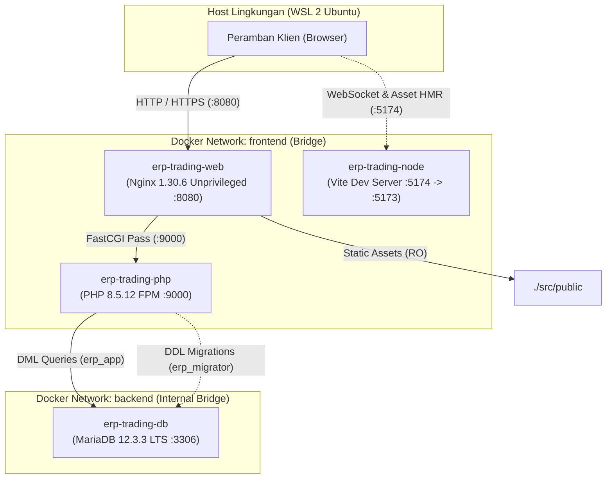
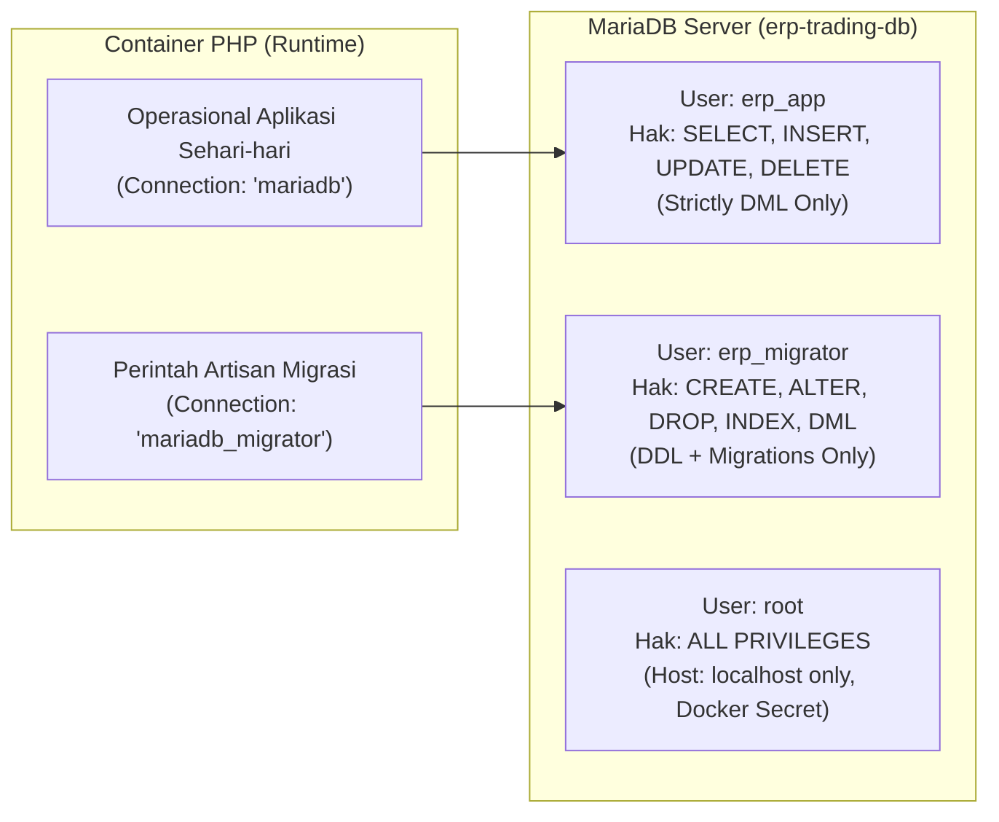
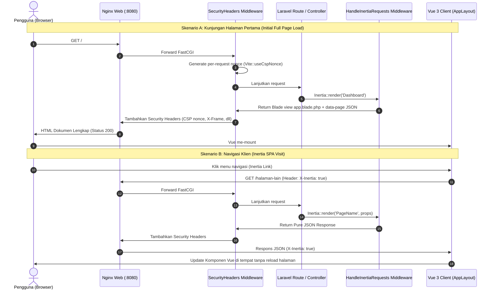

# Arsitektur Monolith & Alur Sistem (Fase 1)

Dokumen ini mendokumentasikan arsitektur sistem monolitik ERP Distribusi / Trading yang dibangun menggunakan Laravel 13, Vue 3 (Inertia.js), Tailwind CSS v4, dan MariaDB 12.3 LTS di atas infrastruktur Docker hardened.

---

## 1. Diagram Arsitektur Keseluruhan

---

## 2. Pemisahan Hak Akses Basis Data (Database Privilege Separation)

Untuk mencegah eksploitasi SQL Injection yang berujung pada perubahan skema tabel atau penghancuran data, hak akses MariaDB dipisahkan secara fisik ke dalam dua kredensial pengguna yang berbeda:

- **`erp_app`**: Digunakan oleh seluruh request web dan API sehari-hari. Jika terjadi celah SQL injection, perintah DDL seperti `DROP TABLE` atau `CREATE TABLE` akan ditolak langsung oleh MariaDB engine (`SQLSTATE[42000] Access/Command denied`).
- **`erp_migrator`**: Kredensial ini **tidak disimpan** di dalam `src/.env` aplikasi. Kredensial diinjeksikan secara temporer dari `.env` root repositori hanya saat menjalankan perintah `make migrate`.
- **`root`**: Terikat secara eksklusif ke host lokal database (`localhost`), kata sandi di-generate secara acak berkekuatan tinggi dan dipasang melalui Docker Compose secret (`secrets/db_root_password.txt`).

---

## 3. Alur Siklus Hidup Request Inertia.js

Inertia.js memungkinkan arsitektur monolitik klasik Laravel menyajikan frontend reaktif Vue 3 tanpa kompleksitas API terpisah:

---

## 4. Isolasi Sistem Berkas & Keamanan Kontainer

- **Prinsip Least Privilege**: Semua kontainer berjalan sebagai user unprivileged (`UID 101` untuk Nginx, `UID 1000` untuk PHP dan Node, `mysql 999` untuk MariaDB).
- **Read-Only Root Filesystem**: Semua kontainer berjalan dengan `read_only: true`. Operasi tulis hanya diizinkan pada partisi temporer `tmpfs` berukuran terbatas (`/tmp`, `/var/run`) dan cache direktori spesifik.
- **Isolasi Berkas Sensitif**: Container PHP hanya me-mount direktori `./src:/var/www/html`. Berkas konfigurasi Docker, `.git`, direktori `secrets/`, dan `.env` infrastruktur tidak dapat diakses sama sekali dari dalam runtime aplikasi.
