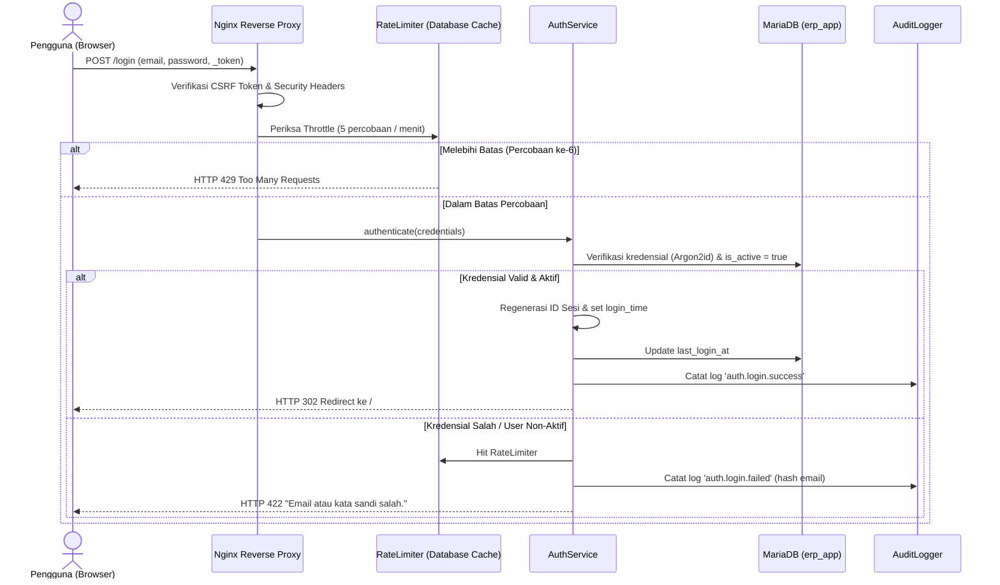

# Arsitektur Autentikasi, Otorisasi RBAC, dan Audit Sesi (Fase 3)

Dokumen ini mendefinisikan arsitektur keamanan identitas, autentikasi, otorisasi berbasis peran (Role-Based Access Control / RBAC), audit logging peristiwa keamanan, serta manajemen siklus hidup sesi untuk proyek ERP Distribusi / Trading.

---

## 1. Pendahuluan & Prinsip Desain

Fase 3 mengimplementasikan sistem autentikasi dan otorisasi monolitik bawaan (native Laravel 13 + Inertia Vue 3) dengan standar kepatuhan tinggi:
- **Tanpa Starter Kit Eksternal**: Tidak menggunakan Laravel Breeze, Fortify, Jetstream, atau Sanctum. Seluruh kontrol alur autentikasi ditulis secara eksplisit dan dapat diaudit penuh.
- **Kredensial Aman**: Algoritma hashing Argon2id (`HASH_DRIVER=argon2id`, `memory_cost=65536`, `time_cost=4`, `threads=1`).
- **Pemisahan Peran (RBAC)**: Otorisasi berbasis hak akses granular (*permissions*) yang dipetakan ke dalam peran sistem (*roles*) melalui skema relasional `roles`, `permissions`, `role_user`, dan `permission_role`.
- **Zero Trust Session**: Sesi terenkripsi di database dengan proteksi ganda *idle timeout* (120 menit) dan *absolute timeout* (480 menit / 8 jam).
- **Audit Logging Otomatis**: Setiap peristiwa login (sukses/gagal), logout, kadaluwarsa sesi, perubahan password, dan penolakan hak akses (403) dicatat secara persisten dan terlindungi di tabel `audit_logs` (*append-only*).

---

## 2. Alur Login, Logout, dan Manajemen Sesi

### A. Alur Autentikasi Masuk (Login Flow)


1. **CSRF Protection**: Permintaan `POST /login` wajib menyertakan token CSRF yang valid melalui cookie `XSRF-TOKEN` atau input `_token`.
2. **Validasi Input**: Validasi ketat format email (`email:rfc,dns` pada production) dan panjang kata sandi minimal 8 karakter.
3. **Pembatasan Laju Berlapis (Rate Limiting)**:
   - **Lapisan 1 (Nginx Reverse Proxy)**: Zona `login_limit` membatasi metode POST pada `/login` berbasis `$binary_remote_addr` fisik (10 request/menit, burst 5 nodelay). Melebihi batas langsung ditolak dengan status HTTP 429 (`limit_req_status 429;`) oleh Nginx.
   - **Lapisan 2 (Aplikasi Laravel)**: Maksimal 5 kegagalan per menit per akun (`login:email:<sha256(email)>`) dan 20 kegagalan per menit per IP (`login:ip:<client_ip>`). Kunci cache menggunakan hash SHA-256 sehingga tidak menyimpan email mentah di database.
4. **Penanganan 429 Terpadu (Inertia vs API)**:
   - Permintaan Inertia (`X-Inertia`): Dilempar via `App\Exceptions\TooManyAttemptsException` yang mengembalikan HTTP 303 Redirect kembali ke halaman login beserta error session bag dan header `Retry-After`. Frontend menampilkan banner peringatan ramah pengguna tanpa dialog modal error 429 bawaan Inertia.
   - Permintaan API/JSON: Mengembalikan status HTTP 429 murni dengan payload JSON `{ message, seconds }` dan header `Retry-After`.
5. **Resistensi Enumerasi Akun**: Jika autentikasi gagal (baik karena email tidak terdaftar, kata sandi salah, atau akun non-aktif), sistem mengembalikan pesan kesalahan generik yang seragam: `"Email atau kata sandi salah."`.
6. **Session Fixation Defense**: Sesaat setelah kredensial terverifikasi, ID sesi di-regenerasi (`$request->session()->regenerate()`) untuk mencegah serangan fiksasi sesi.

### B. Siklus Hidup Sesi & Timeouts
Sesi disimpan menggunakan database driver (`SESSION_DRIVER=database`) pada tabel `sessions`:
- **Atribut Cookie Sesi**: Nama cookie `erp-distribusi-session` dikonfigurasi dengan `HttpOnly=true` (kebal dari pencurian via XSS), `SameSite=Lax` (kebal dari CSRF pihak ketiga), dan `Secure=true` pada lingkungan production.
- **Idle Timeout (120 Menit)**: Dikelola oleh native session lifecycle Laravel (`SESSION_LIFETIME=120`). Sesi dianggap tidak aktif jika tidak ada interaksi selama 2 jam.
- **Absolute Session Lifetime (480 Menit / 8 Jam)**: Ditegakkan oleh middleware `App\Http\Middleware\EnforceSessionTimeouts`. Sesi wajib berakhir setelah 8 jam sejak awal login pertama kali, terlepas dari keaktifan pengguna.
- **Pemeriksaan Keaktifan Akun Runtime**: Middleware `App\Http\Middleware\EnsureUserIsActive` memeriksa status `$user->is_active` pada setiap request terautentikasi. Jika akun pengguna dinonaktifkan oleh administrator, sesi langsung diputus seketika.

### C. Alur Keluar Sistem (Logout Flow)
1. Pengguna menekan tombol "Keluar" pada bilah navigasi profil atas atau menu laci mobile.
2. Form mengirimkan permintaan `POST /logout` dengan token CSRF.
3. Sistem mencatat audit log `auth.logout.success`.
4. Otentikasi dicabut via `Auth::guard('web')->logout()`.
5. Sesi diinvalidasi secara destruktif (`$request->session()->invalidate()`) dan token CSRF di-regenerasi (`$request->session()->regenerateToken()`).
6. Browser dialihkan ke halaman `/login`.

### D. Alur Ganti Kata Sandi (Password Change)
1. Pengguna mengakses menu `/account/password`.
2. Pengguna memasukkan kata sandi saat ini (`current_password`), kata sandi baru, dan konfirmasi kata sandi.
3. **Throttling Kata Sandi Saat Ini**:
   - Pemeriksaan dilakukan di `UpdatePasswordRequest` *sebelum* eksekusi `Hash::check` untuk melindungi CPU dan memori dari serangan brute force Argon2id.
   - Dibatasi maksimal 5 kegagalan per menit per ID pengguna (`password-update:user:{id}`) dan 20 kegagalan per menit per IP (`password-update:ip:{ip}`).
   - Percobaan ke-6 menghasilkan `TooManyAttemptsException` (HTTP 303 Redirect ke form dengan flash error dan header `Retry-After`).
   - Penghitung kegagalan langsung direset seketika saat pergantian kata sandi berhasil.
4. **Kebijakan Kata Sandi Terpadu (`PasswordPolicy`)**:
   - Ditegakkan seragam via `App\Support\PasswordPolicy::rules('email')`.
   - Panjang: minimal 12 karakter, maksimal 128 karakter.
   - Komposisi wajib: minimal 1 huruf besar (*uppercase*), 1 huruf kecil (*lowercase*), dan 1 angka (*number*). Simbol diperbolehkan namun tidak dipaksakan guna mendukung passphrase panjang berkekuatan tinggi.
   - Proteksi profil: dilarang memuat bagian lokal alamat email pengguna jika panjang bagian lokal minimal 4 karakter.
   - Kata sandi baru tidak boleh sama dengan kata sandi saat ini (`different:current_password`).
5. Kata sandi baru di-hash menggunakan Argon2id dan disimpan ke database.
6. Pemanggilan `Auth::logoutOtherDevices($validated['password'])` untuk mencabut seluruh sesi aktif pengguna di peramban atau perangkat lain.
7. Pencatatan log peristiwa keamanan `auth.password.changed`.

---

## 3. Model Ancaman & Mitigasi (Threat Model)

| Vektor Ancaman | Deskripsi Risiko | Mekanisme Mitigasi & Implementasi |
|---|---|---|
| **Brute Force & Credential Stuffing** | Penyerang mencoba ribuan kata sandi terhadap akun tertentu secara berulang | Database RateLimiter membatasi 5 kegagalan per menit per email dan 20 per IP. Percobaan ke-6 menghasilkan HTTP 429 via `TooManyAttemptsException`. Hashing Argon2id berbiaya memori tinggi memperlambat *offline cracking*. |
| **Spoofing IP & X-Forwarded-For Bypass** | Penyerang memalsukan header `X-Forwarded-For` untuk melewati pembatasan laju login | Konfigurasi `TRUSTED_PROXIES` kosong secara default (menghapus seluruh CIDR privat hardcoded), ditambah pertahanan Nginx `limit_req_zone` berbasis `$binary_remote_addr` fisik (10r/m burst 5 nodelay; status 429). |
| **Banjir Audit (Audit Log Flooding / DoS Storage)** | Penyerang sengaja memicu ribuan kegagalan login atau 403 untuk membanjiri tabel `audit_logs` dan menghabiskan disk | Deduplikasi peristiwa audit `login.throttled` (per hash email + IP) dan `access.denied` (per user ID + permission + IP) selama jendela waktu 60 detik. Event sukses dan mutasi data tetap dicatat penuh. |
| **Brute Force Kata Sandi Saat Ini** | Penyerang yang menguasai sesi mencoba menebak `current_password` pada `PUT /account/password` | Throttle khusus verifikasi kata sandi saat ini di `UpdatePasswordRequest` sebelum `Hash::check`: batas 5 kegagalan per menit per pengguna dan 20 per IP. Reset otomatis saat berhasil. |
| **Account Enumeration** | Penyerang membedakan apakah email terdaftar melalui perbedaan pesan kesalahan atau waktu respons | Pesan error generik: `"Email atau kata sandi salah."` pada kegagalan apapun. Perilaku waktu konstan untuk verifikasi hash. |
| **Session Fixation** | Penyerang menyusupkan ID sesi yang telah ditentukan sebelum pengguna masuk | Regenerasi ID sesi mutlak saat autentikasi berhasil (`$request->session()->regenerate()`). |
| **Session Hijacking** | Pencurian cookie sesi pengguna aktif | Cookie `HttpOnly` (tidak dapat diakses JavaScript), `SameSite=Lax`, pembatasan absolut 480 menit, pembersihan sesi instan saat password diubah. |
| **Cross-Site Request Forgery (CSRF)** | Permintaan manipulatif dari situs luar mengatasnamakan sesi pengguna aktif | Validasi middleware `PreventRequestForgery` pada seluruh rute non-GET, cookie SameSite, dan sinkronisasi otomatis token CSRF pada komponen Inertia/Axios. |
| **Privilege Escalation** | Pengguna biasa memanggil endpoint manajemen atau mengubah transaksi yang bukan haknya | Pemeriksaan otorisasi ganda di backend: Middleware `can:<permission>` pada routing dan pemanggilan Gate policy pada controller. Gate::before memvalidasi permission secara strictly dari database. |

### 3.1. Mitigasi Spoofing IP & Bypass X-Forwarded-For
Pada arsitektur Docker/reverse-proxy standar, jika aplikasi Laravel mempercayai rentang IP privat (`172.16.0.0/12`, `10.0.0.0/8`, `192.168.0.0/16`) secara default, Nginx yang berada di jaringan bridge Docker dianggap sebagai proxy tepercaya. Akibatnya, Laravel membaca header `X-Forwarded-For` yang dikirim oleh peramban/penyerang luar dan menggunakannya sebagai `request()->ip()`. Penyerang dapat memutar header ini pada setiap permintaan untuk mem-bypass rate limiter login secara total.

**Arsitektur Pertahanan Berlapis**:
1. **Kebijakan Zero-Trust Proxy**: `TRUSTED_PROXIES` dikonfigurasi kosong (`""`) secara default di `src/config/trustedproxy.php` dan `src/bootstrap/app.php`. Tidak ada CIDR privat yang dipercayai tanpa konfigurasi eksplisit operator infrastruktur.
2. **Nginx Hardware Socket Limiting**: Nginx membatasi koneksi POST ke `/login` menggunakan IP koneksi TCP fisik `$binary_remote_addr` dengan zona `limit_req_zone $login_limit_key zone=login_limit:10m rate=10r/m;`. Jika penyerang membanjiri request dengan IP palsu di header XFF, Nginx tetap memblokir pada koneksi TCP fisik yang sama dengan status HTTP 429.

### 3.2. Penanganan UX Respons 429 (Inertia vs API)
Standardisasi eksepsi 429 diatur melalui `App\Exceptions\TooManyAttemptsException`:
- **Inertia Requests**: Mengembalikan HTTP 303 Redirect back ke form sebelumnya dengan session flash errors dan header `Retry-After`. Frontend (`Login.vue` dan `Password.vue`) menangkap error ini dan merender alert banner ramah pengguna berisi sisa detik penalti, menghindari popup modal crash bawaan Inertia.
- **API / JSON Requests**: Mengembalikan respons standar HTTP 429 *Too Many Requests* dengan payload JSON `{ "message": "...", "retry_after": ... }` dan header `Retry-After`.

### 3.3. Mitigasi Banjir Audit (Audit Storage DoS)
Penyerang yang terus-menerus memicu percobaan login salah atau mengakses rute terlarang dapat menyebabkan ledakan ukuran tabel `audit_logs`.
Layanan `AuditLogger` menerapkan penahanan (*deduplication*) menggunakan cache:
- `login.throttled`: Dikunci selama 60 detik per kombinasi `sha256(email)` dan IP klien. Dalam 60 detik, hanya 1 baris audit log yang ditulis meskipun ada ratusan percobaan brute force.
- `access.denied`: Dikunci selama 60 detik per kombinasi `user_id`, nama permission, dan IP klien.
- Peristiwa sukses (`auth.login.success`, `auth.password.changed`, transaksi data) tidak pernah dideduplikasi.

---

## 4. Katalog Lengkap 98 Permissions

Format penamaan permission mengikuti standar `<resource>.<aksi>` (huruf kecil, *snake_case*). Modul resmi: `administration`, `master_data`, `purchasing`, `inventory`, `sales`, `finance`, `reporting`.

| Modul | Nama Permission | Keterangan & Hak Akses |
|---|---|---|
| **administration** | `users.view` | Melihat daftar dan rincian pengguna |
| **administration** | `users.create` | Membuat akun pengguna baru |
| **administration** | `users.update` | Mengubah informasi akun pengguna |
| **administration** | `users.delete` | Menghapus atau menonaktifkan pengguna |
| **administration** | `roles.view` | Melihat daftar peran dan matriks permission |
| **administration** | `roles.create` | Membuat peran pengguna baru |
| **administration** | `roles.update` | Mengubah nama atau hak akses peran |
| **administration** | `roles.delete` | Menghapus peran (khusus non-sistem) |
| **administration** | `settings.view` | Melihat konfigurasi parameter sistem |
| **administration** | `settings.update` | Mengubah konfigurasi parameter sistem |
| **administration** | `audit_logs.view` | Membaca dan meninjau log audit keamanan |
| **master_data** | `units.view` | Melihat satuan barang (PCS, BOX, KG, dll) |
| **master_data** | `units.create` | Menambah satuan barang baru |
| **master_data** | `units.update` | Mengubah satuan barang |
| **master_data** | `units.delete` | Menghapus satuan barang |
| **master_data** | `product_categories.view` | Melihat kategori produk |
| **master_data** | `product_categories.create` | Menambah kategori produk baru |
| **master_data** | `product_categories.update` | Mengubah kategori produk |
| **master_data** | `product_categories.delete` | Menghapus kategori produk |
| **master_data** | `products.view` | Melihat master katalog produk/barang |
| **master_data** | `products.create` | Menambah master produk baru |
| **master_data** | `products.update` | Mengubah spesifikasi master produk |
| **master_data** | `products.delete` | Menghapus master produk |
| **master_data** | `warehouses.view` | Melihat daftar lokasi gudang |
| **master_data** | `warehouses.create` | Menambah master gudang baru |
| **master_data** | `warehouses.update` | Mengubah data gudang |
| **master_data** | `warehouses.delete` | Menghapus gudang |
| **master_data** | `suppliers.view` | Melihat master pemasok |
| **master_data** | `suppliers.create` | Menambah data pemasok baru |
| **master_data** | `suppliers.update` | Mengubah data pemasok |
| **master_data** | `suppliers.delete` | Menghapus data pemasok |
| **master_data** | `customers.view` | Melihat master pelanggan |
| **master_data** | `customers.create` | Menambah data pelanggan baru |
| **master_data** | `customers.update` | Mengubah data pelanggan |
| **master_data** | `customers.delete` | Menghapus data pelanggan |
| **master_data** | `tax_rates.view` | Melihat tarif pajak (PPN, dll) |
| **master_data** | `tax_rates.create` | Menambah tarif pajak |
| **master_data** | `tax_rates.update` | Mengubah tarif pajak |
| **master_data** | `tax_rates.delete` | Menghapus tarif pajak |
| **master_data** | `payment_terms.view` | Melihat syarat pembayaran (CASH, NET30, dll) |
| **master_data** | `payment_terms.create` | Menambah syarat pembayaran |
| **master_data** | `payment_terms.update` | Mengubah syarat pembayaran |
| **master_data** | `payment_terms.delete` | Menghapus syarat pembayaran |
| **purchasing** | `purchase_orders.view` | Melihat Pesanan Pembelian (PO) |
| **purchasing** | `purchase_orders.create` | Membuat draft Pesanan Pembelian |
| **purchasing** | `purchase_orders.update` | Mengubah Pesanan Pembelian |
| **purchasing** | `purchase_orders.approve` | Menyetujui (Approve) Pesanan Pembelian |
| **purchasing** | `purchase_orders.void` | Membatalkan (Void) Pesanan Pembelian |
| **purchasing** | `goods_receipts.view` | Melihat Penerimaan Barang (GR) |
| **purchasing** | `goods_receipts.create` | Membuat draft Penerimaan Barang |
| **purchasing** | `goods_receipts.update` | Mengubah Penerimaan Barang |
| **purchasing** | `goods_receipts.post` | Memposting Penerimaan Barang ke inventori |
| **purchasing** | `goods_receipts.void` | Membatalkan Penerimaan Barang |
| **purchasing** | `purchase_invoices.view` | Melihat Faktur Pembelian (PI) |
| **purchasing** | `purchase_invoices.create` | Membuat Faktur Pembelian |
| **purchasing** | `purchase_invoices.update` | Mengubah Faktur Pembelian |
| **purchasing** | `purchase_invoices.post` | Memposting Faktur Pembelian ke hutang usaha |
| **purchasing** | `purchase_invoices.void` | Membatalkan Faktur Pembelian |
| **inventory** | `stock_adjustments.view` | Melihat Penyesuaian Stok (Stock Adjustment) |
| **inventory** | `stock_adjustments.create` | Membuat draft Penyesuaian Stok |
| **inventory** | `stock_adjustments.update` | Mengubah Penyesuaian Stok |
| **inventory** | `stock_adjustments.post` | Memposting Penyesuaian Stok |
| **inventory** | `stock_adjustments.void` | Membatalkan Penyesuaian Stok |
| **inventory** | `stock_balances.view` | Melihat saldo kuantitas stok per gudang |
| **inventory** | `stock_movements.view` | Melihat riwayat pergerakan/kartu stok |
| **sales** | `sales_orders.view` | Melihat Pesanan Penjualan (SO) |
| **sales** | `sales_orders.create` | Membuat draft Pesanan Penjualan |
| **sales** | `sales_orders.update` | Mengubah Pesanan Penjualan |
| **sales** | `sales_orders.approve` | Menyetujui (Approve) Pesanan Penjualan |
| **sales** | `sales_orders.void` | Membatalkan Pesanan Penjualan |
| **sales** | `delivery_orders.view` | Melihat Surat Jalan / Pengiriman (DO) |
| **sales** | `delivery_orders.create` | Membuat draft Surat Jalan |
| **sales** | `delivery_orders.update` | Mengubah Surat Jalan |
| **sales** | `delivery_orders.post` | Memposting Surat Jalan (mengurangi fisik stok) |
| **sales** | `delivery_orders.void` | Membatalkan Surat Jalan |
| **sales** | `sales_invoices.view` | Melihat Faktur Penjualan (SI) |
| **sales** | `sales_invoices.create` | Membuat Faktur Penjualan |
| **sales** | `sales_invoices.update` | Mengubah Faktur Penjualan |
| **sales** | `sales_invoices.post` | Memposting Faktur Penjualan ke piutang usaha |
| **sales** | `sales_invoices.void` | Membatalkan Faktur Penjualan |
| **finance** | `chart_of_accounts.view` | Melihat Bagan Akun (COA) |
| **finance** | `chart_of_accounts.create` | Menambah akun perkiraan baru |
| **finance** | `chart_of_accounts.update` | Mengubah akun perkiraan |
| **finance** | `chart_of_accounts.delete` | Menghapus akun perkiraan |
| **finance** | `payments.view` | Melihat Pembayaran Kas & Bank |
| **finance** | `payments.create` | Mencatat transaksi pembayaran kas/bank |
| **finance** | `payments.update` | Mengubah draft pembayaran |
| **finance** | `payments.post` | Memposting pembayaran ke buku besar |
| **finance** | `payments.void` | Membatalkan pembayaran |
| **finance** | `journals.view` | Melihat Jurnal Umum Akuntansi |
| **finance** | `journals.create` | Membuat entri jurnal umum |
| **finance** | `journals.update` | Mengubah draft jurnal umum |
| **finance** | `journals.post` | Memposting jurnal umum ke buku besar |
| **finance** | `journals.void` | Membatalkan jurnal umum |
| **reporting** | `reports.view_sales` | Melihat laporan performa dan analisis penjualan |
| **reporting** | `reports.view_purchasing`| Melihat laporan pembelian dan analisa pemasok |
| **reporting** | `reports.view_inventory` | Melihat laporan valuasi dan mutasi inventori |
| **reporting** | `reports.view_finance` | Melihat laporan neraca, laba rugi, dan arus kas |

*Total: Tepat 98 Hak Akses (Permissions).*

---

## 5. Matriks Peran Sistem (7 System Roles)

Sistem ERP Distribusi/Trading dilengkapi 7 peran bawaan (*built-in system roles*):

1. **`super_admin` (98 Permissions)**:
   Akses penuh tanpa kecuali ke seluruh 98 hak akses sistem.
2. **`admin` (59 Permissions)**:
   Pengelolaan master data, pengguna, peran, konfigurasi sistem, dan log audit, serta hak melihat (view) seluruh dokumen transaksi dan laporan. Dilarang melakukan operasi mutasi transaksi keuangan tingkat lanjut (*approve*, *post*, *void* dokumen keuangan).
3. **`purchasing` (18 Permissions)**:
   Akses data pemasok, pembuatan hingga persetujuan Pesanan Pembelian (`purchase_orders.*`), peninjauan penerimaan barang (`goods_receipts.view`), peninjauan faktur pembelian (`purchase_invoices.view`), saldo stok, dan laporan pembelian.
4. **`warehouse` (24 Permissions)**:
   Pengelolaan operasional fisik barang: Penerimaan Barang (`goods_receipts.*`), Pengiriman/Surat Jalan (`delivery_orders.*`), Penyesuaian Stok (`stock_adjustments.*`), peninjauan pesanan pembelian/penjualan, mutasi stok, dan laporan inventori.
5. **`sales` (17 Permissions)**:
   Akses data pelanggan, pembuatan hingga persetujuan Pesanan Penjualan (`sales_orders.*`), peninjauan surat jalan (`delivery_orders.view`), peninjauan faktur penjualan (`sales_invoices.view`), saldo persediaan, dan laporan penjualan.
6. **`finance` (35 Permissions)**:
   Pengelolaan keuangan penuh: Bagan Akun (`chart_of_accounts.*`), Faktur Penjualan (`sales_invoices.*`), Faktur Pembelian (`purchase_invoices.*`), Kas/Bank (`payments.*`), Jurnal Akuntansi (`journals.*`), dan laporan keuangan.
7. **`viewer` (24 Permissions)**:
   Akses hanya baca (*read-only*) terhadap seluruh dokumen transaksi operasional (PO, SO, GR, DO, PI, SI, Payment, Journal), saldo stok, mutasi stok, serta seluruh laporan bisnis. Tidak memiliki akses baca ke data pengguna, peran, pengaturan, maupun log audit.

---

## 6. Mekanisme Otorisasi & Caching

### A. Evaluasi Hak Akses via Gate
Evaluasi hak akses dilakukan di `AppServiceProvider::boot()` menggunakan `Gate::before`:
```php
Gate::before(function (User $user, string $ability): ?bool {
    if ($user->hasPermission($ability)) {
        return true;
    }

    return null; // Melanjutkan evaluasi policy atau default false
});
```

### B. In-Memory Request Caching
Untuk menghindari permasalahan *N+1 query* saat puluhan pengecekan `can:` dieksekusi dalam satu siklus request HTTP:
- Model `User` menyimpan daftar permission di properti array in-memory `$this->permissionNamesCache`.
- Permintaan izin pertama kali memuat seluruh permission dari relasi `$this->roles()->with('permissions')->get()`.
- Pengecekan berikutnya selama siklus request HTTP yang sama hanya memeriksa *hash map* in-memory `isset(...)`, dengan kompleksitas O(1) tanpa menyentuh database kembali.

### C. Pembagian Status Hak Akses ke Frontend (Inertia Props)
Middleware `HandleInertiaRequests` membagikan daftar permission pengguna aktif ke client:
```php
'auth' => [
    'user' => $request->user() ? [
        'id' => $request->user()->id,
        'name' => $request->user()->name,
        'email' => $request->user()->email,
    ] : null,
    'permissions' => $request->user() ? $request->user()->getPermissionNames() : [],
],
```
Komponen antarmuka `AppLayout.vue` dan konfigurasi navigasi `navigation.js` secara otomatis menyembunyikan tautan menu yang tidak diizinkan untuk pengguna tersebut.

---

## 7. Audit Logging Keamanan

Setiap peristiwa keamanan dicatat melalui layanan `App\Services\Audit\AuditLogger` ke tabel `audit_logs`:
- **Integritas Immutabilitas**: Tabel `audit_logs` dilindungi trigger basis data MariaDB (`tr_audit_logs_before_update` dan `tr_audit_logs_before_delete`) yang membatalkan upaya `UPDATE` atau `DELETE` (*append-only*).
- **Sanitasi Kredensial**:
  - Kolom `new_values` dan `old_values` secara otomatis memindai kunci payload dengan ekspresi reguler `/password|token|secret|key/i` dan mengganti nilainya dengan string `[REDACTED]`.
  - Pemindaian sanitasi bekerja secara rekursif terhadap struktur *nested array*.
- **Perlindungan Privasi Email pada Audit**:
  - Email pada percobaan login gagal tidak dicatat dalam bentuk teks mentah (*raw plaintext*).
  - Layanan menyimpan hash kriptografis `sha256(strtolower(trim($email)))` dalam kolom payload `email_hash` untuk memungkinkan investigasi korelasi insiden tanpa menyimpan data sensitif.
- **Deduplikasi Peristiwa Keamanan (Anti-Flooding)**:
  - Peristiwa berulang dengan frekuensi tinggi (`login.throttled` dan `access.denied`) dideduplikasi secara otomatis dengan jendela waktu 60 detik melalui atomic lock cache `Cache::add()`.
  - Mengeliminasi risiko kepenuhan kapasitas tabel (*storage denial of service*) akibat serangan automated brute force atau crawler tanpa izin.
- **Resiliensi Sistem**:
  - Operasi pencatatan audit dibungkus dalam blok penanganan eksepsi `try-catch`.
  - Jika terjadi gangguan penyimpanan log audit, proses autentikasi pengguna tidak digagalkan, dan kegagalan dicatat ke log darurat `Log::critical`.

---

## 8. Panduan Operasional CLI & Manajemen Akun

### A. Membuat Super Administrator Pertama
Jalankan perintah interaktif berikut di terminal:
```bash
make artisan cmd="erp:admin:create"
```
Perintah akan meminta:
- Nama Lengkap Pengguna
- Alamat Email (wajib unik)
- Kata Sandi (minimal 12 karakter, input tersembunyi)
- Konfirmasi Kata Sandi

Akun yang dibuat akan langsung diverifikasi dan diberikan peran `super_admin`.

### B. Reset Kata Sandi Pengguna via CLI
Jika pengguna lupa kata sandi atau terkunci:
```bash
make artisan cmd="erp:user:reset-password user@example.com"
```
Administrator akan diminta memasukkan kata sandi baru secara interaktif tanpa menampilkan karakter di layar. Seluruh sesi aktif pengguna target akan dicabut seketika.

### C. Mengaktifkan atau Menonaktifkan Pengguna
Untuk mencabut akses staf yang keluar atau mengaktifkan kembali akun:
```bash
# Menonaktifkan akses:
make artisan cmd="erp:user:set-active user@example.com false"

# Mengaktifkan akses kembali:
make artisan cmd="erp:user:set-active user@example.com true"
```

### D. Menyelaraskan Katalog Permission & Role
Jika seeder permission atau role diperbarui di masa mendatang:
```bash
make artisan cmd="erp:permissions:sync"
```
Perintah ini melakukan sinkronisasi *idempoten* (upsert data baru dan membersihkan relasi yang usang tanpa menghapus akun pengguna).

---

## 9. Batasan Desain yang Disengaja (Deliberate Limitations)

1. **Tanpa Otentikasi Dua Faktor (2FA / MFA)**:
   Fitur 2FA (TOTP via Google Authenticator) sengaja ditangguhkan dan dijadwalkan pada Fase 12 (Hardening Enterprise Lanjutan) untuk menjaga fokus fase fondasi.
2. **Tanpa Reset Kata Sandi via Email**:
   Sistem tidak mengaktifkan alur lupa kata sandi via email publik guna menghindari risiko kebocoran data (*account enumeration*) dan penyalahgunaan infrastruktur mail server yang belum dikonfigurasi. Reset dilakukan oleh Super Admin melalui CLI atau secara mandiri saat pengguna masuk.
3. **Tanpa Registrasi Publik**:
   Sistem ERP adalah aplikasi internal tertutup (*enterprise boundary*). Tidak ada endpoint registrasi publik (`/register`).
4. **Tanpa Cookie "Remember Me"**:
   Fitur *Remember Me* jangka panjang dinonaktifkan secara sengaja. Seluruh sesi dibatasi strictly dengan batas maksimum 480 menit (8 jam) demi postur keamanan kerja harian.
5. **Tanpa Antarmuka CRUD Pengguna di UI**:
   Manajemen pembuatan pengguna dan pemetaan peran via web interface akan diimplementasikan pada Fase 6 (Modul Administrasi). Pada Fase 3, pengelolaan akun dilakukan melalui Artisan CLI yang terlindungi.
