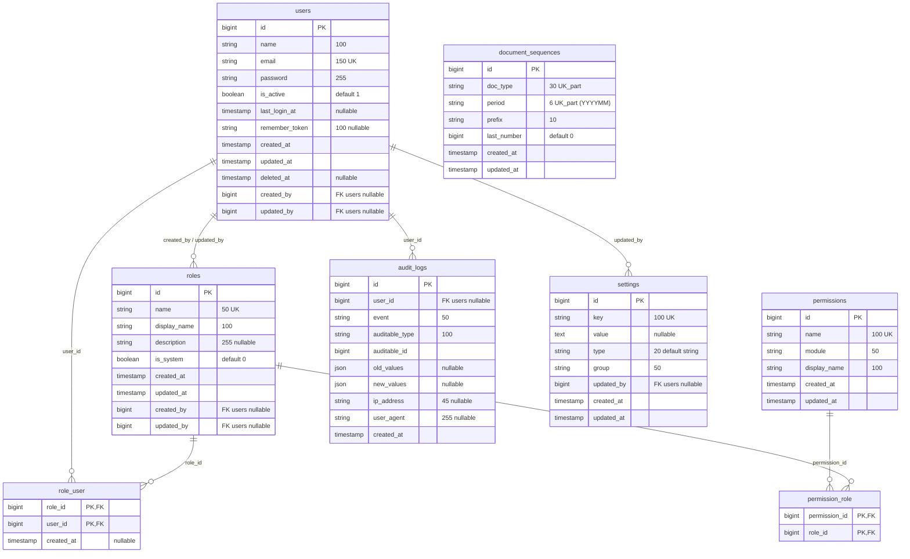
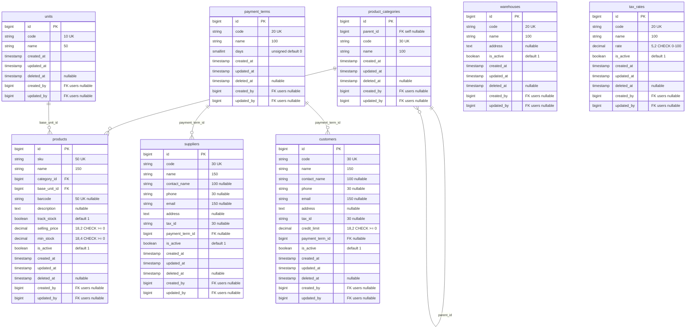
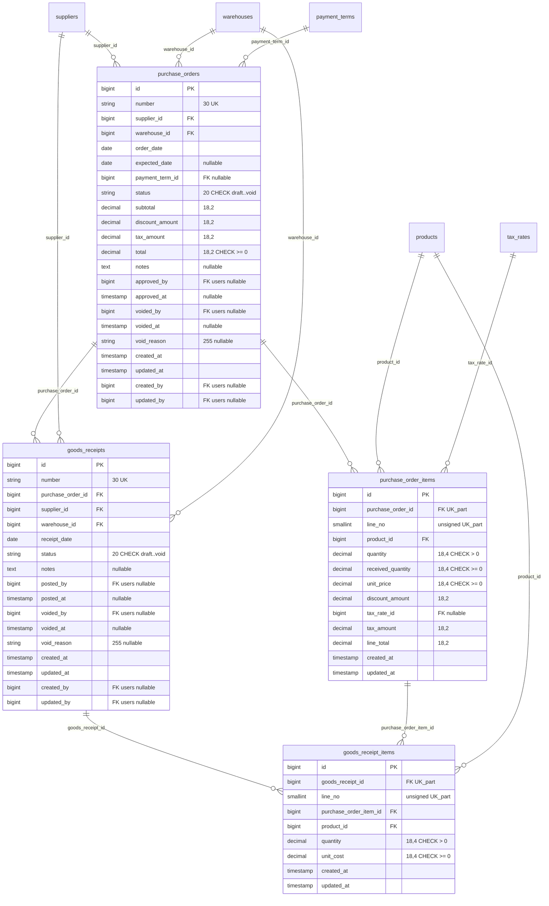
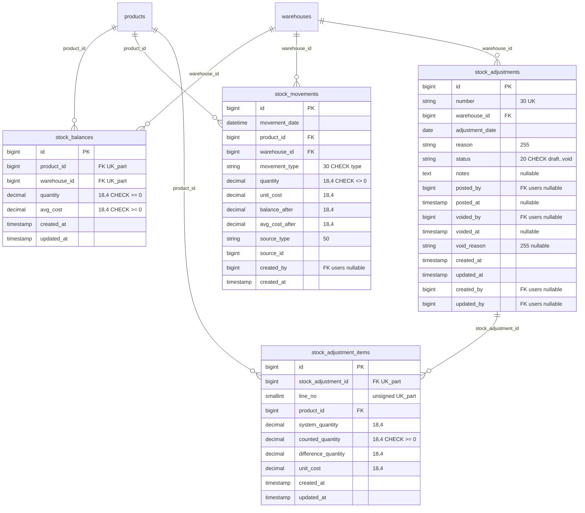
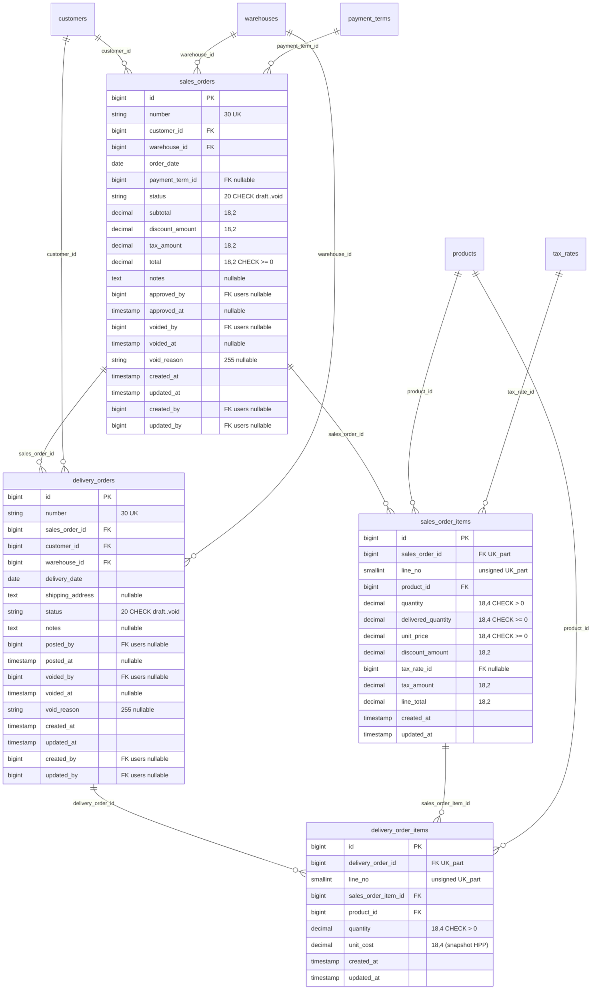

# Entity Relationship Diagram (ERD) - ERP Distribusi/Trading

Dokumen ini mendefinisikan Entity Relationship Diagram (ERD) untuk seluruh 37 tabel domain pada arsitektur database ERP Distribusi/Trading. Diagram disajikan menggunakan sintaks Mermaid `erDiagram` terstruktur per modul domain bisnis beserta pemetaan relasi antar modul.

---

## 1. Modul Administrasi & Keamanan (8 Tabel)

---

## 2. Modul Master Data (8 Tabel)

---

## 3. Modul Pembelian / Pengadaan (4 Tabel)

---

## 4. Modul Inventori & Gudang (4 Tabel)

---

## 5. Modul Penjualan & Distribusi (4 Tabel)

---

## 6. Modul Keuangan & Akuntansi (9 Tabel)

```mermaid
erDiagram
    chart_of_accounts ||--o{ chart_of_accounts : "parent_id"
    journals ||--o{ journals : "reversal_of_id"
    journals ||--o{ journal_lines : "journal_id"
    chart_of_accounts ||--o{ journal_lines : "account_id"
    customers ||--o{ sales_invoices : "customer_id"
    sales_orders ||--o{ sales_invoices : "sales_order_id"
    journals ||--o{ sales_invoices : "journal_id"
    sales_invoices ||--o{ sales_invoice_items : "sales_invoice_id"
    products ||--o{ sales_invoice_items : "product_id"
    delivery_order_items ||--o{ sales_invoice_items : "delivery_order_item_id"
    tax_rates ||--o{ sales_invoice_items : "tax_rate_id"
    suppliers ||--o{ purchase_invoices : "supplier_id"
    purchase_orders ||--o{ purchase_invoices : "purchase_order_id"
    journals ||--o{ purchase_invoices : "journal_id"
    purchase_invoices ||--o{ purchase_invoice_items : "purchase_invoice_id"
    products ||--o{ purchase_invoice_items : "product_id"
    goods_receipt_items ||--o{ purchase_invoice_items : "goods_receipt_item_id"
    tax_rates ||--o{ purchase_invoice_items : "tax_rate_id"
    customers ||--o{ payments : "customer_id"
    suppliers ||--o{ payments : "supplier_id"
    chart_of_accounts ||--o{ payments : "account_id"
    journals ||--o{ payments : "journal_id"
    payments ||--o{ payment_allocations : "payment_id"
    sales_invoices ||--o{ payment_allocations : "sales_invoice_id"
    purchase_invoices ||--o{ payment_allocations : "purchase_invoice_id"

    chart_of_accounts {
        bigint id PK
        string code "20 UK"
        string name "150"
        string type "20 CHECK"
        string normal_balance "6 CHECK"
        bigint parent_id "FK self nullable"
        boolean is_postable "default 1"
        boolean is_active "default 1"
        timestamp created_at
        timestamp updated_at
        timestamp deleted_at "nullable"
        bigint created_by "FK users nullable"
        bigint updated_by "FK users nullable"
    }

    journals {
        bigint id PK
        string number "30 UK"
        date journal_date
        string description "255"
        string source_type "50 nullable"
        bigint source_id "nullable"
        string status "20 CHECK"
        decimal total_debit "18,2"
        decimal total_credit "18,2"
        bigint reversal_of_id "FK self nullable"
        bigint posted_by "FK users nullable"
        timestamp posted_at "nullable"
        bigint voided_by "FK users nullable"
        timestamp voided_at "nullable"
        string void_reason "255 nullable"
        timestamp created_at
        timestamp updated_at
        bigint created_by "FK users nullable"
        bigint updated_by "FK users nullable"
    }

    journal_lines {
        bigint id PK
        bigint journal_id "FK UK_part"
        smallint line_no "unsigned UK_part"
        bigint account_id FK
        decimal debit "18,2 CHECK"
        decimal credit "18,2 CHECK"
        string description "255 nullable"
        timestamp created_at
        timestamp updated_at
    }

    sales_invoices {
        bigint id PK
        string number "30 UK"
        bigint customer_id FK
        bigint sales_order_id "FK nullable"
        date invoice_date
        date due_date
        string status "20 CHECK"
        decimal subtotal "18,2"
        decimal discount_amount "18,2"
        decimal tax_amount "18,2"
        decimal total "18,2"
        decimal paid_amount "18,2 CHECK <= total"
        bigint journal_id "FK nullable"
        text notes "nullable"
        bigint posted_by "FK users nullable"
        timestamp posted_at "nullable"
        bigint voided_by "FK users nullable"
        timestamp voided_at "nullable"
        string void_reason "255 nullable"
        timestamp created_at
        timestamp updated_at
        bigint created_by "FK users nullable"
        bigint updated_by "FK users nullable"
    }

    sales_invoice_items {
        bigint id PK
        bigint sales_invoice_id "FK UK_part"
        smallint line_no "unsigned UK_part"
        bigint product_id "FK nullable"
        bigint delivery_order_item_id "FK nullable"
        string description "255"
        decimal quantity "18,4 CHECK > 0"
        decimal unit_price "18,4"
        decimal discount_amount "18,2"
        bigint tax_rate_id "FK nullable"
        decimal tax_amount "18,2"
        decimal line_total "18,2"
        timestamp created_at
        timestamp updated_at
    }

    purchase_invoices {
        bigint id PK
        string number "30 UK"
        bigint supplier_id "FK UK_part"
        bigint purchase_order_id "FK nullable"
        string supplier_invoice_number "50 UK_part"
        date invoice_date
        date due_date
        string status "20 CHECK"
        decimal subtotal "18,2"
        decimal discount_amount "18,2"
        decimal tax_amount "18,2"
        decimal total "18,2"
        decimal paid_amount "18,2 CHECK <= total"
        bigint journal_id "FK nullable"
        text notes "nullable"
        bigint posted_by "FK users nullable"
        timestamp posted_at "nullable"
        bigint voided_by "FK users nullable"
        timestamp voided_at "nullable"
        string void_reason "255 nullable"
        timestamp created_at
        timestamp updated_at
        bigint created_by "FK users nullable"
        bigint updated_by "FK users nullable"
    }

    purchase_invoice_items {
        bigint id PK
        bigint purchase_invoice_id "FK UK_part"
        smallint line_no "unsigned UK_part"
        bigint product_id "FK nullable"
        bigint goods_receipt_item_id "FK nullable"
        string description "255"
        decimal quantity "18,4 CHECK > 0"
        decimal unit_price "18,4"
        decimal discount_amount "18,2"
        bigint tax_rate_id "FK nullable"
        decimal tax_amount "18,2"
        decimal line_total "18,2"
        timestamp created_at
        timestamp updated_at
    }

    payments {
        bigint id PK
        string number "30 UK"
        string payment_type "20 CHECK"
        bigint customer_id "FK nullable"
        bigint supplier_id "FK nullable"
        date payment_date
        string method "30 CHECK"
        bigint account_id FK
        decimal amount "18,2 CHECK > 0"
        string reference "100 nullable"
        string status "20 CHECK"
        bigint journal_id "FK nullable"
        text notes "nullable"
        bigint posted_by "FK users nullable"
        timestamp posted_at "nullable"
        bigint voided_by "FK users nullable"
        timestamp voided_at "nullable"
        string void_reason "255 nullable"
        timestamp created_at
        timestamp updated_at
        bigint created_by "FK users nullable"
        bigint updated_by "FK users nullable"
    }

    payment_allocations {
        bigint id PK
        bigint payment_id "FK UK_part"
        bigint sales_invoice_id "FK nullable UK_part"
        bigint purchase_invoice_id "FK nullable UK_part"
        decimal amount "18,2 CHECK > 0"
        timestamp created_at
        timestamp updated_at
    }
```

